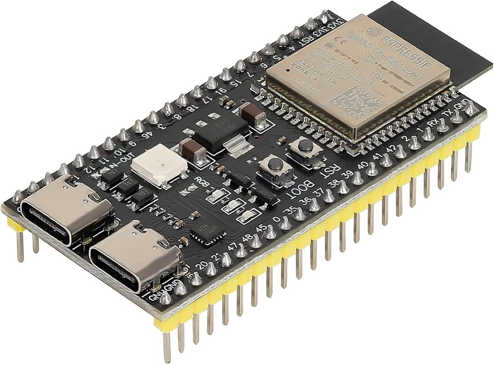

# ESP32-S3 Audio and Embedded Systems Projects

This repository contains experiments and projects based on the ESP32-S3-WROOM-1-N16R8 development board, focusing on embedded programming, I2S audio, digital microphones, audio amplification, and memory management.

The ESP32-S3 provides Wi-Fi connectivity, I2S peripherals, and support for external PSRAM, making it suitable for audio processing and network-connected embedded applications.

## Hardware

- **Microcontroller:** ESP32-S3-WROOM-1-N16R8
- **Flash Memory:** 16 MB
- **PSRAM:** 8 MB
- **Digital Microphone:** INMP441 I2S microphone
- **Audio Amplifier:** MAX98357A I2S amplifier
- **Output:** Speaker connected to the MAX98357A amplifier

## Features and Experiments

- **Board Configuration:** Configuring and testing the ESP32-S3 using the Arduino IDE.
- **PSRAM Testing:** Detecting and verifying external PSRAM for memory-intensive applications.
- **I2S Audio Output:** Testing digital audio output through the MAX98357A amplifier.
- **Digital Audio Input:** Testing microphone input using the INMP441 I2S microphone.
- **Network Audio:** Experimenting with retrieving audio files over a local Wi-Fi network.
- **Memory Management:** Exploring RAM and PSRAM allocation for audio buffers and processing.
- **Embedded Audio Processing:** Investigating audio capture, playback, and streaming.

